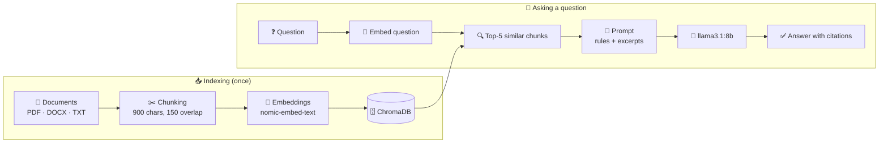

<div align="center">

# 📚 HR Policy RAG

### Ask questions about HR policies, employee handbooks and compliance documents, fully offline

A privacy-first **Retrieval-Augmented Generation (RAG)** system that runs entirely on your own machine. Your documents never leave your computer: no cloud, no API keys, no external services.


</div>

---

## 📑 Contents

- [Why this project?](#-why-this-project)
- [Key Features](#-key-features)
- [How It Works](#%EF%B8%8F-how-it-works)
- [Example](#-example)
- [Getting Started](#-getting-started)
- [Configuration](#%EF%B8%8F-configuration)
- [Use Cases](#-use-cases)
- [Disclaimer](#-disclaimer)

---

## 💡 Why this project?

HR handbooks and policy documents are long, scattered across many files, and hard to search. At the same time, they often contain internal information that shouldn't be sent to a cloud AI service.

This project answers questions about those documents using a **local LLM**, so nothing leaves your machine. Every answer is grounded in the retrieved document text and comes with **citations** (`source file | chunk`), so you can check where each statement came from.

---

## ✨ Key Features

| | Feature | Details |
|---|---|---|
| 🔒 | **Fully local** | Embeddings, vector search and generation all run on your machine; ChromaDB telemetry is turned off |
| 📄 | **Multiple formats** | Loads **PDF**, **DOCX** and **TXT** files |
| 🎯 | **Grounded answers** | The model may only use the retrieved excerpts, and says so when the answer isn't in them |
| 🔖 | **Citations** | Every statement points to its source file and chunk |
| 🧠 | **Local models** | `llama3.1:8b` for answers, `nomic-embed-text` for embeddings, both via Ollama |
| ⚡ | **Reproducible setup** | One-command install with `uv` and a lock file |

---

## ⚙️ How It Works



1. **Load:** reads every PDF, DOCX and TXT file in `data/`
2. **Chunk:** splits the text into overlapping pieces with LangChain's `RecursiveCharacterTextSplitter`
3. **Embed and store:** turns each chunk into a vector with `nomic-embed-text` and saves it in ChromaDB (`db/`)
4. **Retrieve:** finds the 5 chunks most similar to the question
5. **Generate:** `llama3.1:8b` answers using only those chunks, with strict grounding rules and citations

---

## 🔎 Example

> **Query:** What are the things that I should not do in the workplace?

```
Based on the provided policy excerpts, here is a list of things that you should not do in the workplace:

* Engage in any activity that is illegal under local, state, federal or international law while
  utilizing Holiday Market-owned resources. (Computer Use Policy.pdf | chunk 9)
* Make threats, even as a joke or prank, during working hours or in company vehicles. (handbook.pdf | chunk 34)
* Work for any company in direct competition with Holiday Market without written consent. (handbook.pdf | chunk 83)
* Solicit other associates during working time. (handbook.pdf | chunk 83)
* Distribute literature on company premises during working time, except as permitted by management.
  (handbook.pdf | chunk 83)
```

More example questions and answers are in [`main_rag.ipynb`](main_rag.ipynb).

---

## 🚀 Getting Started

### Prerequisites

- 🐍 **Python 3.11+**
- 🦙 **[Ollama](https://ollama.com)**
- ⚡ **[uv](https://docs.astral.sh/uv/)**: install with `pip install uv`
- 💻 About **8 GB of RAM** for `llama3.1:8b`; no GPU needed

### 1️⃣ Get the models

```bash
ollama pull nomic-embed-text
ollama pull llama3.1:8b
```

Make sure Ollama is running. The desktop app runs it in the background; otherwise use `ollama serve`.

### 2️⃣ Clone and install

```bash
git clone https://github.com/Aditya74747/hr-policy-rag.git
cd hr-policy-rag
uv sync
```

<details>
<summary>Without uv (plain pip)</summary>

```bash
python -m venv .venv
.venv\Scripts\activate          # Windows
# source .venv/bin/activate     # macOS / Linux
pip install -r requirements.txt
```

</details>

### 3️⃣ Add your documents

Put your PDF, DOCX or TXT files into a `data/` folder in the project root. It's created automatically on the first run, and it's git-ignored so your documents are never committed.

```
hr-policy-rag/
└── data/
    ├── handbook.pdf
    ├── leave-policy.docx
    └── it-guidelines.txt
```

### 4️⃣ Run the notebook

```bash
uv run jupyter notebook
```

Open `main_rag.ipynb` and run all cells from top to bottom. The indexing cell builds the vector database in `db/`. It may take a few minutes the first time, and running it again rebuilds the database from scratch.

Then ask your own questions:

```python
print(ask("What is the notice period for resignation?"))
```

---

## 🛠️ Configuration

All settings are at the top of the notebook:

| Setting | Default | What it does |
|---|---|---|
| `DATA_DIR` | `data` | Folder with your documents |
| `DB_DIR` | `db` | Where ChromaDB stores the vectors |
| `chunk_size` / `chunk_overlap` | `900` / `150` | Size of each text chunk and how much neighbouring chunks overlap |
| `k` in `ask()` | `5` | How many chunks are given to the model |
| LLM model | `llama3.1:8b` | Any Ollama model works, e.g. `qwen3:8b` or `mistral` |
| `temperature` | `0.2` | Kept low for factual, consistent answers |

---

## 🧰 Tech Stack

| Component | Technology |
|---|---|
| Language | Python 3.11+ |
| LLM runtime | Ollama (`llama3.1:8b`) |
| Embeddings | `nomic-embed-text` via Ollama |
| Vector store | ChromaDB |
| RAG framework | LangChain |
| Document parsing | `pypdf`, `python-docx` |
| Environment | `uv` + Jupyter Notebook |

---

## 🎯 Use Cases

- 🏖️ HR policy questions: leave, probation, payroll, resignation
- 💻 IT and acceptable-use policy lookup
- 📋 Internal SOP and compliance reference
- 🙋 Employee self-service knowledge assistant
- ✅ Audit and policy verification support

---

## 📌 Disclaimer

This repository contains **code only**. The documents used during development (for example the Holiday Market employee handbook and computer use policy) come from publicly available sources and are **not included**. All third-party documents remain the property of their respective owners.

Answers are generated by an LLM and can be incomplete or wrong. Always check the cited source before acting on an answer.

## 📄 License

[MIT](LICENSE)
